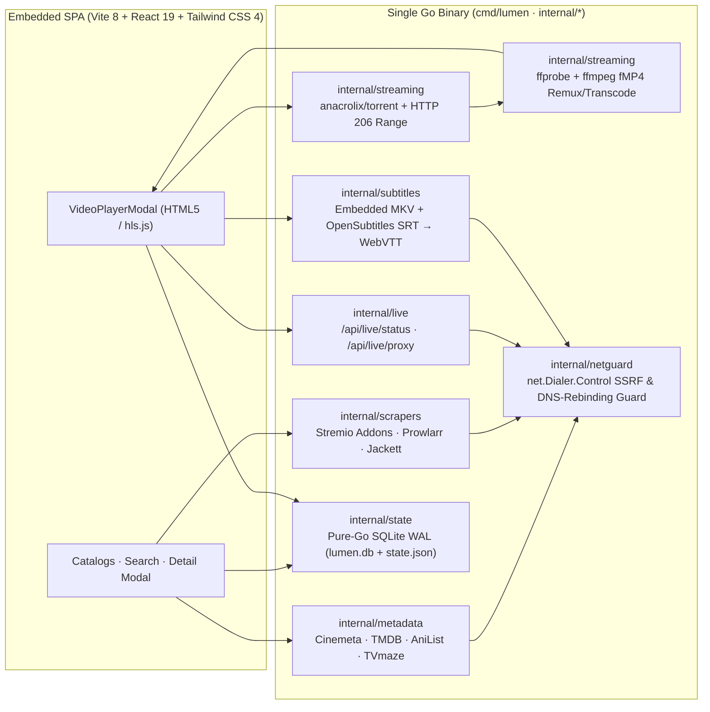

# Lumen

[](https://github.com/jvanheerikhuize/lumen/actions/workflows/ci.yml)
[](https://github.com/jvanheerikhuize/lumen/actions/workflows/docker.yml)
[](LICENSE)
[](go.mod)

**A zero-config, single-binary self-hosted streaming dashboard for your home network.**

Browse movies, TV series, and anime from free, keyless catalogs, watch 1,700+ free-to-air live TV channels, and stream torrents directly in your browser — compiled into a single Go binary with an embedded Vite/React 19 SPA, embedded SQLite state store, and on-the-fly `ffmpeg` conversion for MKV, HEVC/x265, AC3, EAC3, and DTS.

No accounts, cloud logins, or mandatory API keys required.

---

## Highlights

- **Movies & Series** from [Cinemeta](https://v3-cinemeta.strem.io) with genre/year filters, IMDb ratings, and full season/episode guides. Optional [TMDB](https://www.themoviedb.org/) integration when `TMDB_API_KEY` is provided.
- **Anime** from [AniList](https://anilist.co) (trending, seasonal, popular, and top-rated), automatically cross-referenced via [Fribb/anime-lists](https://github.com/Fribb/anime-lists) to Kitsu and IMDb IDs for episode streams and subtitles.
- **Personalized & Fresh Every Open:** Randomized hero banner that never repeats recently shown titles, automatic genre taste learning, interactive genre filter chips, **"Picked for You"** & **"Your Liked Titles"** rows, **"Continue Watching"** with per-episode resume memory, **"Up Next"** auto-advance, and atomic multi-device LAN state sync (`/api/state` backed by embedded SQLite WAL).
- **What's On Today:** "New episodes today" row and live series status (*"Returning series · Next: S2 · E5"*) powered by [TVmaze](https://www.tvmaze.com).
- **Live TV:** ~1,700 free-to-air channels from [Free-TV/IPTV](https://github.com/Free-TV/IPTV) plus curated international news/sports feeds, with category/country/favorite filters, background batch on-air verification, and a built-in CORS HLS relay (`/api/live/proxy`).
- **Smart Torrent Streaming (`anacrolix/torrent`):**
  - Queries Stremio addons ([Torrentio](https://torrentio.strem.fun) and MediaFusion by default; add custom manifests in Settings) plus optional self-hosted **Prowlarr** and **Jackett** indexers.
  - Prioritizes first and last pieces (`moov` atom / MKV `Cues`) plus a dynamic read-ahead window for fast startup and seeking, ranks sources by browser streamability, and automatically fails over if a swarm stalls.
  - Announces to a daily-refreshed list of live [public trackers](https://github.com/ngosang/trackerslist) and evicts idle swarms after 20 minutes.
- **Plays Almost Anything in Any Browser:** `ffprobe` inspects every stream before playback; H.264/AAC MP4/WebM streams play directly (`206 Partial Content`), while MKV/AVI containers are remuxed (`-c:v copy`) and HEVC/AV1/AC3/DTS streams are transcoded on the fly to fragmented MP4 (`fMP4`) with full seek support and optional hardware acceleration (`LUMEN_HWACCEL`).
- **Embedded & External Subtitles:** Extracts embedded MKV subtitle tracks via `ffmpeg` and fetches external subtitles from OpenSubtitles, with live `±0.5s` sync adjustment (`G`/`H`).

---

## How Lumen Compares

| Capability | Lumen | Stremio Web | Jellyfin + \*arr Stack |
| :--- | :--- | :--- | :--- |
| **Zero-Account / No Cloud Login** | Yes | Requires Stremio account sync | Yes |
| **Built-in Torrent Engine + `ffmpeg` Remux/Transcode** | Built-in (`lumen` Go binary + `ffmpeg`) | Needs external local companion service | Requires separate qBittorrent + Radarr/Sonarr |
| **Stremio Addon + Prowlarr/Jackett Support** | Both built-in | Stremio Addons only | Prowlarr/Jackett via \*arr |
| **1,700+ Free-to-Air Live TV + CORS Relay** | Built-in | Via third-party addons | Requires M3U tuner setup |
| **Setup Time** | **1 command (`docker compose up -d`)** | Cloud web app + local server | Multi-container stack |

---

## Quick Start (Docker — Recommended)

Run Lumen with `ffmpeg` pre-installed in a single lightweight Alpine container:

```bash
docker compose up -d
```

Or with `docker run`:

```bash
docker run -d \
  --name lumen \
  -p 3000:3000 \
  --restart unless-stopped \
  ghcr.io/jvanheerikhuize/lumen:latest
```

Then open **http://localhost:3000** (or `http://<your-lan-ip>:3000` from any TV, tablet, or phone on your home network).

---

## Local Build & Installation (Single Go Binary)

### Requirements
- **Go 1.24+**
- **Node.js 22.18+** (for building the embedded Vite/React 19 SPA bundle)
- **`ffmpeg` and `ffprobe`** on your `PATH`:
  - Debian / Ubuntu: `sudo apt install ffmpeg`
  - macOS: `brew install ffmpeg`

```bash
git clone https://github.com/jvanheerikhuize/lumen.git
cd lumen
npm install
npm run build                        # Builds the Vite + React 19 SPA into web/dist
go build -o bin/lumen ./cmd/lumen    # Compiles the single Go binary with embedded web/dist
./bin/lumen                          # Starts Lumen on http://localhost:3000
```

---

## Architecture



---

## Configuration

Everything works out of the box with zero configuration. Optional environment variables can be set in your shell or passed to Docker via `compose.yaml` (see [`.env.example`](.env.example)):

| Variable | Description |
| :--- | :--- |
| `PORT` | HTTP listen port for the single binary (defaults to `3000`). |
| `LUMEN_DATA_DIR` | Directory for the embedded SQLite database (`lumen.db`) and `state.json` mirror (defaults to `./data` locally, `/app/data` in Docker). |
| `TMDB_API_KEY` | Optional [TMDB API key](https://www.themoviedb.org/settings/api) for TMDB trending lists and metadata. |
| `PROWLARR_URL`, `PROWLARR_API_KEY` | Query your self-hosted Prowlarr instance for every movie and series. |
| `JACKETT_URL`, `JACKETT_API_KEY` | Query your self-hosted Jackett Torznab endpoint for every movie and series. |
| `LUMEN_ALLOW_PRIVATE_ADDONS` | Set to `1` to allow Stremio addons hosted on private RFC1918 LAN addresses. |
| `LUMEN_INTERNAL_PORT` | Internal HTTP port Lumen listens on when behind a reverse proxy on `80`/`443` (defaults to `PORT` or `3000`). |
| `LUMEN_HWACCEL` | Optional hardware video encoding: `vaapi`, `nvenc`, `qsv`, `videotoolbox`, or `none`. |

---

## Player Keyboard Shortcuts

| Key | Action |
| :--- | :--- |
| `/` | Focus global search bar (when player is closed) |
| `Space` / `K` | Play / Pause |
| `←` / `→` | Seek backward / forward 10 seconds |
| `↑` / `↓` | Previous / Next Live TV channel |
| `F` | Toggle fullscreen |
| `P` | Toggle Picture-in-Picture |
| `M` | Toggle mute |
| `C` | Toggle subtitles on / off |
| `G` / `H` | Subtitle sync `−0.5s` / `+0.5s` |
| `Esc` | Close menus or exit player |

---

## Development

```bash
npm run dev         # Start Vite dev server (proxies /api/* to http://127.0.0.1:3000)
npm run typecheck   # Run TypeScript compiler checks (tsc --noEmit)
npm test            # Run Go test suite (go test ./...) + frontend TypeScript unit tests
npm run spec:check  # Validate ASDLC Meta-Specs record graph (--strict)
npm run spec:render # Render stack-agnostic Markdown & Gherkin specs to dist/
npm run build       # Build Vite SPA bundle into web/dist
```

---

## Domain Specifications (`ASDLC Meta-Specs`)

Lumen's domain knowledge is extracted into **35 atomic, tech-stack-agnostic epistemic records** in [`records/`](records/) following [ASDLC Meta-Specs](https://github.com/jvanheerikhuize/asdlc-meta-specs) (`Facts → Requirements → Specs`, with `Assumptions` and `Questions` explicitly tracked and promoted as empirical evidence is gathered).

Explore the interactive **Dashboard, Tasks, Record Graph, and Capture Workspace** on GitHub Pages: **[https://jvanheerikhuize.github.io/lumen/](https://jvanheerikhuize.github.io/lumen/)**

| Spec | Tier | Readiness | Scope |
| :--- | :--- | :--- | :--- |
| [`SPC-0001`](records/SPC-0001-core-catalog-and-adaptive-playback-skeleton.md) | `skeleton` | **100%** | Keyless catalogs (`REQ-0001`), stream ranking (`REQ-0002`), P2P head/tail piece priority (`REQ-0003`), 3-tier adaptive playback (`REQ-0004`), stall failover (`REQ-0005`) |
| [`SPC-0002`](records/SPC-0002-embedded-and-external-subtitle-pipeline.md) | `feature` | **100%** | Embedded & external subtitle pipeline with WebVTT normalization and `±0.5s` sync (`REQ-0006`) |
| [`SPC-0003`](records/SPC-0003-taste-personalization-and-household-progress.md) | `feature` | **33%** | Randomized hero & genre taste learning (`REQ-0007`), watch progress & atomic LAN state sync (`REQ-0008`), live broadcast schedules (`REQ-0009`) |
| [`SPC-0004`](records/SPC-0004-free-to-air-live-television-and-hls-relay.md) | `feature` | **100%** | ~1,700 free-to-air live TV channels, batch on-air probing, and HLS CORS manifest relay (`REQ-0010`) |
| [`SPC-0005`](records/SPC-0005-network-boundary-protection-and-indexers.md) | `feature` | **100%** | Outbound SSRF & socket-level DNS-rebinding protection (`REQ-0011`) and custom addons + Prowlarr/Jackett indexers (`REQ-0012`) |

```bash
python3 tools/spec.py check --strict          # Validate links, epistemic gates, open questions, and stack-agnosticism
python3 tools/spec.py impact FCT-0003         # Trace downstream requirements and topological spec rebuild order
python3 tools/spec.py render --tier skeleton  # Render only the Walking Skeleton spec to dist/
```

---

## Security

Lumen is designed for a trusted home network (or private VPN/Tailscale mesh). It does not include user authentication, so do not expose it directly to the public internet without an authenticating reverse proxy. All upstream fetches validate DNS and redirect hops and enforce socket-level IP verification (`net.Dialer.Control`) against SSRF and DNS rebinding into link-local or private networks. See [SECURITY.md](SECURITY.md) for details.

## Disclaimer

Lumen does not host, store, or distribute any media content. It aggregates metadata and stream links from public catalogs, user-configured addons/indexers, and public BitTorrent swarms. You are solely responsible for complying with applicable laws in your jurisdiction.

## License

Released under the [MIT License](LICENSE).
